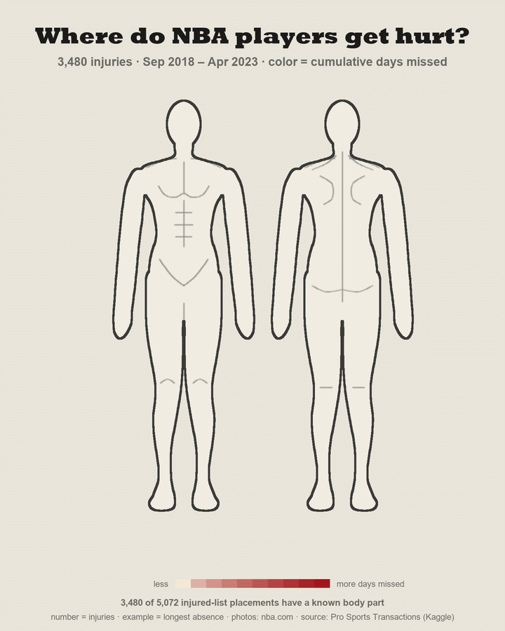

# nba-injury-atlas

**Où se blessent les joueurs NBA, et combien ça coûte ?** Un GIF animé et deux dashboards [marimo](https://marimo.io) construits à partir des mises sur la liste des blessés (saisons 2018-19 à 2022-23), des logs de matchs et des salaires.



Le GIF (720 × 900, ~26 s, ~10 Mo) enchaîne quatre scènes :

1. **Où se blessent les joueurs** : silhouette de face et de dos, zones colorées par jours d'absence cumulés, avec pour chaque zone le nombre de blessures et un joueur exemple (absence la plus longue).
2. **Les ruptures des ligaments croisés** : une barre par rupture, de la mise sur la liste des blessés au premier match joué.
3. **Le genou, la blessure la plus chère** : salaires versés pendant les absences au genou.
4. **Les 3 franchises les plus touchées** depuis 2010-11 (jours d'absence cumulés).

## Résultats (à la date de génération)

| | |
|---|---|
| Blessures localisées (zone du corps connue) | 3 480 sur 5 072 mises sur la liste, sept. 2018 – avr. 2023 |
| Genou | ≈ 753 M$ de salaires, 13 835 jours d'absence (zone la plus chère) |
| Ruptures du croisé | 13 ruptures, ≈ 128 M$, 0,5 % des blessures mais 4,3 % des jours d'absence |
| Franchises (2010-11 → 2022-23) | Warriors 4 156 j, Bucks 4 047 j, Nets 4 029 j : **podium très serré** |

## Fichiers

| Fichier | Rôle |
|---|---|
| `make_gif.py` | Génère `body_map.gif` (Pillow + [slack-gif-creator](https://skills.sh/anthropics/skills/slack-gif-creator) pour l'assemblage) |
| `bodymap.py` | Nettoyage des notes de blessure, zone du corps, durée d'absence, classement des franchises, formes du corps |
| `prep.py` | Table joueur-saison : salaire, matchs manqués, coût (dashboard) |
| `nba_injuries.py` | Dashboard marimo : coût des absences par franchise, saison, joueur |
| `nba_body_map.py` | Dashboard marimo : carte du corps interactive |
| `fetch_games.py` | Télécharge les logs de matchs (`nba_api`) |

## Installation

```bash
pip install -r requirements.txt
npx skills add anthropics/skills@slack-gif-creator -g -y   # utilitaires GIF (GIFBuilder, easing) utilisés par make_gif.py
```

`make_gif.py` utilise les polices Windows (`C:/Windows/Fonts` : Rockwell Extra Bold, Arial). Sur un autre système, adapter `FONTS`, `SLAB`, `BOLD`, `REG`.

## Données (non incluses dans le dépôt, dossier `data/` ignoré)

- **Blessures** : dataset Kaggle [`loganlauton/nba-injury-stats-1951-2023`](https://www.kaggle.com/datasets/loganlauton/nba-injury-stats-1951-2023) (issu de Pro Sports Transactions), jusqu'en avril 2023. À enregistrer sous `data/injuries_kaggle.csv`. Vérifier la licence.
  ```python
  import kagglehub; print(kagglehub.dataset_download("loganlauton/nba-injury-stats-1951-2023"))
  ```
- **Logs de matchs** : `python fetch_games.py` crée `data/player_games_*.csv` et `data/team_games_*.csv` (2010-11 à 2022-23).
- **Salaires** : un fichier par saison `data/salaries_<année de début>.csv` (2018 à 2022 pour le GIF), colonnes `team` (ex. `boston-celtics`), `season`, `player_id`, `player`, `salary`, `cap_hit`, `two_way`, `terminated`. Ils ont été relevés sur les pages équipe de HoopsHype ; ils ne sont pas redistribués ici. Vérifier les conditions du site avant de réutiliser ces données.
- **Photos** : téléchargées automatiquement depuis nba.com au premier lancement de `make_gif.py` (cache `data/headshots/`). Ces images sont protégées : ne pas republier le GIF sans vérifier les droits.

## Utilisation

```bash
python fetch_games.py                       # une fois
python make_gif.py                          # -> body_map.gif (~2 min)
python -m marimo run nba_injuries.py        # dashboard coût des absences
python -m marimo run nba_body_map.py        # carte du corps interactive
```

## Méthode et limites

- **Absence** : jours entre la mise sur la liste des blessés et la première des deux dates suivantes : la transaction suivante du joueur, ou son premier match joué (le dataset oublie certains retours ; sans le plafonnement par le premier match, le coût du genou était surestimé d'environ 7 %). Sinon, mi-avril.
- **Coût** : salaire de la saison au prorata des jours passés sur la liste des blessés pendant la saison régulière (20 oct. – 12 avr.). C'est une **estimation**, plutôt un minimum : les absences jamais déclarées sur la liste ne sont pas comptées.
- **Zone du corps** : repérage par mots-clés dans les notes (« sprained left ankle »). Gauche et droite sont regroupées. 1 592 mises sur la liste n'ont aucun détail ou sont des maladies / protocoles COVID : elles ne sont pas localisées.
- **Ruptures du croisé** : seulement 13 ruptures distinctes dans les données (beaucoup d'absences ne passent jamais par la liste). Le retour est le premier match joué, car les dates « activated from IL » du dataset sont parfois fausses ou absentes.
- **Classement des franchises** : fragile. Les 5 premières sont à moins de 4 % d'écart, et le top 3 change selon la période ou le périmètre (toutes les blessures : Nets, Warriors, 76ers). Il mesure les arrêts déclarés, pas toutes les absences. Bobcats = Hornets ; « Hornets » avant juillet 2013 = Pelicans.
- **Silhouette** : contour humain dessiné à la main (courbes), pas une illustration anatomique.
